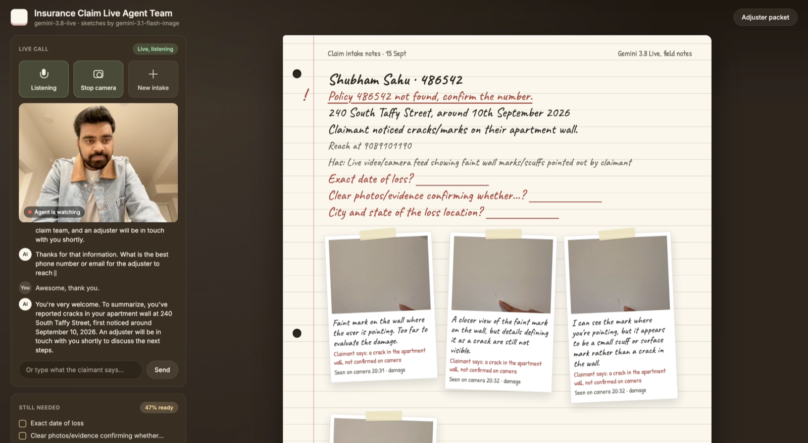

# Insurance Claim Live Agent Team

An insurance claim agent that talks, listens, looks at damage through your camera, and sketches the incident while the conversation continues. Built in TypeScript on [LiveKit Agents](https://docs.livekit.io/agents/), with OpenAI GPT-Live for full-duplex voice and a Tavus avatar for the face.

The agent records details in a field notebook, checks mock policy records, and asks for missing information. A background claim team applies intake rules and prepares a downloadable claim packet with notes, captured evidence, and illustrations for human review.



## How it fits together

| Piece | Runs on | Job |
| --- | --- | --- |
| Voice | OpenAI GPT-Live (`gpt-live-1`) | Listens and speaks at the same time, handles barge-in, calls tools through its backend Responses model |
| Face | Tavus avatar via `@livekit/agents-plugin-tavus` | Joins the room and lip-syncs the agent's audio |
| Claim team | LiveKit Inference | Extracts facts, classifies the claim, verifies camera frames, draws sketches |
| Rules | Local TypeScript | Validation, coverage and evidence gates, document checklist, fraud and safety routing, Markdown packet |
| Browser | `livekit-client` | Mic, camera, avatar playback, transcript, notebook, packet ZIP |

GPT-Live is not served through LiveKit Inference, so it needs its own `OPENAI_API_KEY`. Without that key the agent falls back to a speech-to-text, LLM, text-to-speech pipeline that runs entirely on LiveKit Inference.

## Setup

Requires Node.js 20 or newer and a LiveKit Cloud project.

```bash
npm install
cp .env.example .env
```

Fill in `.env`:

```dotenv
LIVEKIT_URL=wss://your-project.livekit.cloud
LIVEKIT_API_KEY=...
LIVEKIT_API_SECRET=...
TAVUS_API_KEY=...
OPENAI_API_KEY=...        # GPT-Live; leave empty to use the Inference voice pipeline
```

Start the agent worker and the web UI together:

```bash
npm run dev
```

Open [127.0.0.1:4177](http://127.0.0.1:4177/).

* **Talk:** join the call and unmute the mic.
* **Show camera:** share the damage. The agent captures frames as evidence.
* **Text box:** send a typed turn into the same call.
* **Adjuster packet:** preview and download the packet ZIP.
* **New intake:** leave the room and start fresh in a new one.

Each intake is its own LiveKit room and agent job. State lives in that job only. Download the packet before you leave; it is never submitted to an insurer.

## Scripts

| Command | What it does |
| --- | --- |
| `npm run dev` | Bundle the browser client, then run the agent (dev mode) and web server |
| `npm run agent` | Agent worker only, in dev mode |
| `npm run agent:start` | Agent worker in production mode |
| `npm run web` | Bundle the browser client and serve the UI |
| `npm run typecheck` | Typecheck the Node and browser code |
| `npm run build` | Compile to `dist/` and bundle `public/app.js` |

## Configuration

Restart after changing `.env`.

| Variable | Default | Purpose |
| --- | --- | --- |
| `LIVEKIT_URL`, `LIVEKIT_API_KEY`, `LIVEKIT_API_SECRET` | Required | Room connection, token minting, and LiveKit Inference |
| `TAVUS_API_KEY` | Empty | Tavus avatar; empty means voice only |
| `TAVUS_FACE_ID`, `TAVUS_PAL_ID` | Tavus stock | Avatar appearance and PAL. A custom PAL must use `pipeline_mode` `echo` with LiveKit transport |
| `OPENAI_API_KEY` | Empty | GPT-Live voice; empty selects the Inference voice pipeline |
| `FNOL_VOICE_MODEL` | `gpt-live-1` | GPT-Live voice model |
| `FNOL_VOICE` | `marin` | GPT-Live voice |
| `FNOL_BACKEND_MODEL` | `gpt-5.6-luna` | GPT-Live backend model that decides tool calls |
| `FNOL_CLAIM_MODEL` | `openai/gpt-5-mini` | Fact extraction and classification |
| `FNOL_VISION_MODEL` | Claim model | Camera frame verification |
| `FNOL_SKETCH_MODEL` | `openai/gpt-5` | Incident sketches, drawn as SVG |
| `FNOL_FALLBACK_LLM` | `openai/gpt-4.1-mini` | Conversation model for the Inference voice pipeline |
| `FNOL_STT_MODEL`, `FNOL_TTS_MODEL` | `deepgram/nova-3`, `cartesia/sonic-3` | Inference voice pipeline |
| `FNOL_TTS_VOICE` | `9626c31c-bec5-4cca-baa8-f8ba9e84c8bc` | Cartesia voice ID; the default is Jacqueline, a female American voice |
| `FNOL_AGENT_NAME` | `insurance-claim-agent` | Explicit dispatch name shared by the worker and token server |
| `FNOL_AVATAR_MODEL_LABEL` | `Tavus Phoenix 4.5` | Avatar label shown in the UI |
| `FNOL_WEB_HOST`, `FNOL_WEB_PORT` | `127.0.0.1`, `4177` | Web server bind address |

## Camera and sketch behavior

GPT-Live does not take video input, so the voice model never claims to see the camera itself. When the claimant shows something, the agent calls the evidence tool. That tool grabs the newest frame from the claimant's LiveKit video track, has the vision model describe it independently, and reports back what is actually visible.

| Input | Behavior |
| --- | --- |
| Camera off, with enough incident detail | Draw an illustration |
| Camera on, showing damage | Capture and independently verify the frame |
| Unclear camera view | Ask for a clearer view |
| Explicit diagram request | Draw in either camera mode |
| Correction to a sketch | Redraw using the corrected details |

* Greetings, vague descriptions, and no-loss inspections do not trigger automatic sketches.
* Sketches are illustrations, not photographic evidence. They are model-written SVG, sanitized before display.
* Documents described as available are not marked received until a capture succeeds.
* The avatar's video never counts as evidence; only the claimant's camera track is captured.

## Background tools

`lookup_policy`, `sync_claim_packet`, `pin_evidence_photo`, and `draw_incident_sketch` run in a LiveKit `AsyncToolset`. Each slow tool reports progress right away, so the conversation keeps going, and its result is delivered when the agent is next idle. A safety escalation or a lapsed or unknown policy interrupts the agent's current sentence. The claim team also reruns after every finalized claimant turn and caches the result by transcript revision.

## Try a claim

Use this fictional example with the camera off:

> I'm Maya Singh, policy H0-44721. Our basement flooded when the sump pump failed.
>
> Nobody is hurt. Water entered by the stairs and spread across the carpet toward the boxes.

### Mock policies

| Policy | Policyholder | Type | Status |
| --- | --- | --- | --- |
| H0-44721 | Maya Singh | Homeowners | Active |
| AUTO-90210 | Jordan Lee | Auto | Active |
| RNT-3008 | Priya Shah | Renters | Active |
| TRV-7711 | Alex Chen | Travel | Active |
| MED-5520 | Sam Rivera | Medical reimbursement | Active |
| AUTO-11111 | Chris Park | Auto | Lapsed |

Unknown, lapsed, mismatched, and out-of-period policies route to human review. These records are examples, not a carrier connection.

## Code map

| Path | Responsibility |
| --- | --- |
| `src/agent.ts` | LiveKit worker: voice model, Tavus avatar, camera tap, background tools, state publishing |
| `src/intake.ts` | Per-call state, cached claim workflow, evidence capture, sketches, notebook state |
| `src/prompts.ts` | Voice persona, tool rules, camera notices, sketch prompt |
| `src/claim/workflow.ts` | Claim team: Inference extraction and classification, then the rule pipeline |
| `src/claim/policies.ts`, `schemas.ts` | Deterministic rules, routing, packet, and Zod schemas |
| `src/claim/policyDirectory.ts` | Mock policy records |
| `src/server.ts` | Local web server and LiveKit token minting with agent dispatch |
| `src/web/app.ts` | Browser client, bundled to `public/app.js` |
| `public/` | HTML shell and styles |

The browser and agent talk over LiveKit text streams. The agent publishes notebook state on `claim.state` and errors on `claim.event`. Typed turns go to the agent on `lk.chat`, and live captions arrive on `lk.transcription`.
